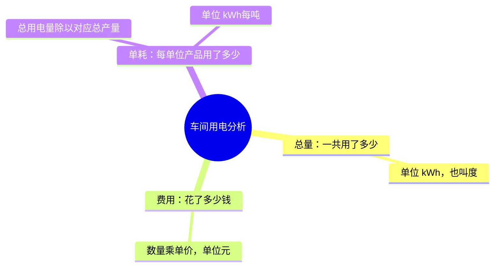

# 第4天：总量、费用与单耗

以下算例均为教学假设，不是真实工厂记录。项目生成器产出的是模拟数据。

同一天、相同产品和统计边界下，A车间用电1000 kWh、产量100吨、电价0.8元/kWh，费用800元，电耗10 kWh/吨。B车间用电1500 kWh、产量200吨，同价费用1200元，电耗7.5 kWh/吨。B总量更大，单位产品用电更少；不能据此证明设备或改造的因果效果。

实际代码：sql/analysis.sql 第63行汇总消耗，第66行汇总费用；第374行计算单位产品电耗，第376行汇总电力，第382行起从独立产量事实表汇总产量。SUM表示求和；NULLIF(p.qty,0)将零产量变为NULL，避免除零，NULL代表该指标不可计算，不是零。

跨期单耗应先汇总再相除：两天分别1000 kWh/100吨和1500 kWh/200吨，合计2500/300，约8.33 kWh/吨，不能直接平均10与7.5。项目其他指标的聚合规则需分别核对，不能认定所有单耗查询都采用同一聚合方式。

练习：用电2400 kWh，产量300吨，电价0.75元/kWh，求总量、费用和电耗。参考：2400 kWh、1800元、8 kWh/吨。

检查1：总量上升，是否说明单位产品能耗上升？参考：不能，需结合对应产量计算。
检查2：产量为零而设备仍耗电，单耗为零吗？参考：不是，不能除以零；单耗不可计算，但仍保留能耗和费用。

进度：用户明确请求第4天；已讲解，掌握待反馈，不标记此前课程或本课已掌握。
