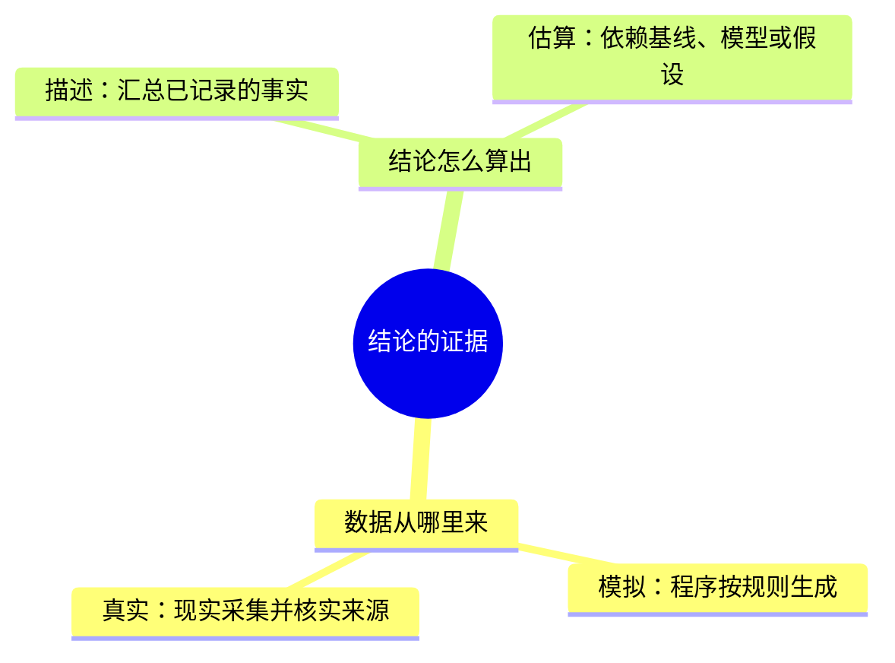

# 第5天：模拟数据、真实数据与估算边界

模拟与真实描述来源；估算描述推算方式，真实数据也能用于估算，二者不是三个互斥类别。

实际代码：src/generate_data.py第3行声明模拟ERP/MES导出，第22行设定产量增长5%、单耗下降3%，因此生成后看到下降趋势不能证明真实改造效果。tools/fetch_real_industrial_data.py第28行起配置公开UCI数据下载和来源文件。data/real/uci_steel_energy/provenance.json记录来源、抓取时间和文件校验值；CSV首条记录Usage_kWh=3.17，本次只读取本地资料，未重新下载或独立核验现场计量。该公开数据不能当作模拟车间的真实记录。

src/make_report.py第190行起用历史单耗作为基线推算差额。教学假设：基线10度/吨，当前8度/吨，当前产量100吨，基线推算1000度，当前800度，相差200度。应称相对基线估算少用200度，不能直接说某项改造实测节电200度。基线指用于比较的参考水平，因果指某措施确实导致某结果。

练习：把“程序生成的记录显示单耗下降3%，证明工厂改造节能3%”改成符合证据的说法。参考：模拟记录呈现单耗下降趋势，反映生成器设定，不能证明真实工厂改造效果。

检查1：字段data_source=MES能证明真实来源吗？参考：不能，模拟行也可带该标签。
检查2：用真实电表数据和假设电价算费用，是实际账单吗？参考：不是，是假设电价下的费用估算，仍需核实实际计费条款。

用户第4天反馈已理解，本课为第5天，掌握与练习等待反馈。仅教学材料，不启动下载、服务或实验。
