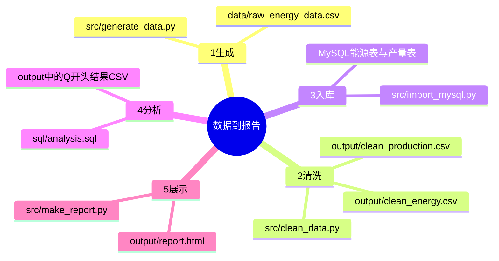

# 第6天：五步流程与文件地图

今天只读代码，不启动服务、不运行生成或装载。前课已答对模拟/真实边界选择题，不代表完整掌握或完成独立复现。

生成=按规则制作模拟数据；清洗=按规则统一、纠错、去重并留痕；入库=把数据装进数据库；分析=查询计算指标；展示=把结果组织为图表和页面。CSV是表格文本，MySQL是数据库系统，SQL是查询语言，HTML是网页格式。

代码证据：src/clean_data.py第278行读取原始CSV，第568、569行写能源和产量CSV；src/import_mysql.py第597、599行装载两张事实表，第617行起在run-analysis选项开启时读取并执行分析SQL；src/make_report.py第3至7行说明读取查询结果并生成report.html。README.md第65至68行列出四条运行命令，入库与分析共用一个脚本，因此业务五步不等于五条命令。报告还使用清洗后的CSV支持部分分析，不应认为它只读取Q结果文件。

教学假设：同一车间一天两条电力数据1000度和1200度，日期不同且电价均为0.8元/度。生成得到模拟明细，清洗检查单位与重复，入库保存，分析得到两天总用电2200度、费用1760元，展示画成图。统计有值不等于真实工厂事实；真实公开数据走单独采集与分析路径，不能当作自动替换模拟数据的输入。基于假设或历史基线的金额/节能差额仍是估算。

练习：单位写法混乱找哪个文件？想改单位产品电耗算法先看哪个文件？参考：src/clean_data.py；sql/analysis.sql中的相关查询，并需进一步核实指标依赖，今天不改代码。

检查1：想让图表更好看，应先改原始消耗量吗？参考：不应，应定位展示层；改数据会改变统计事实。
检查2：四条命令为什么对应五步？参考：import_mysql.py兼做入库与按选项执行SQL分析。

进度：第6天已讲解，理解与练习待用户反馈。
