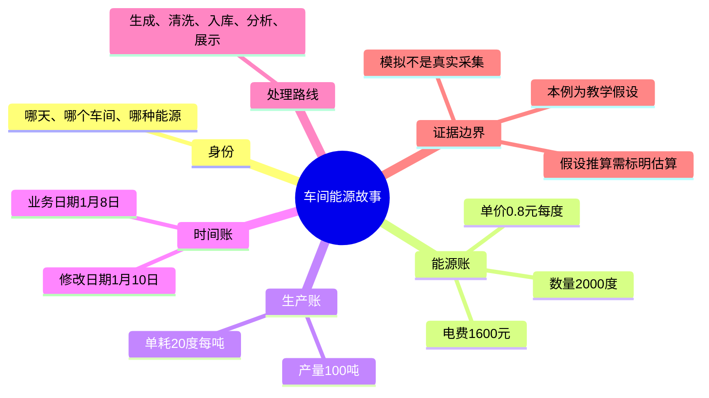

# 第7天：第一周复习——复述一个完整业务例子

教学假设：1月8日熔炼车间用电2000 kWh，电价0.8元/kWh，产量100吨；记录于1月10日修正。费用1600元，电耗20 kWh/吨。业务日期仍1月8日，更新时间反映1月10日。其他能源行重复携带100吨，不可重复累计。

术语：kWh为千瓦时即度；单耗是每单位产品的能源消耗；业务日期为统计归属日期；更新时间用于表达记录版本更新时间。

实际代码：src/generate_data.py第218至228行生成日期、数量、单价、费用、产量字段；src/clean_data.py第501至505行按日期与车间整理独立产量；sql/analysis.sql第374行将同月同车间电量除以产量。本例是日尺度手算，与月度查询共享比值概念，不是实际执行结果。

五步：生成模拟小票；清洗并留痕；入库存明细；分析算费用与单耗；展示出报告。真实数据需核验采集来源，模拟数据入库或清洗不会变为真实。真实电量乘假设价格仍为估算费用。不能由单耗下降直接证明某改造有效。

练习：改为2400度、0.75元/度、120吨，请用一句话复述日期车间、电费、电耗，以及这是何种数据。参考：教学假设中，1月8日熔炼车间用电2400度，生产120吨，按假设电价计算电费1800元，电耗20度/吨，并非真实账单。

检查1：电力、天然气两条记录都带产量100吨，应计200吨吗？参考：不能，同一车间同一天的同一份产量只计100吨。
检查2：保存明细与计算总电费分别是哪步？参考：第三步入库、第四步分析。

第7天已讲解，等待用户复述，不自动标记前六天完全掌握。仅生成教学材料并更新进度，未运行数据流水线。
